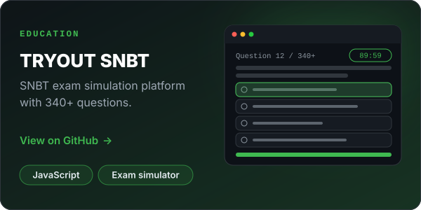
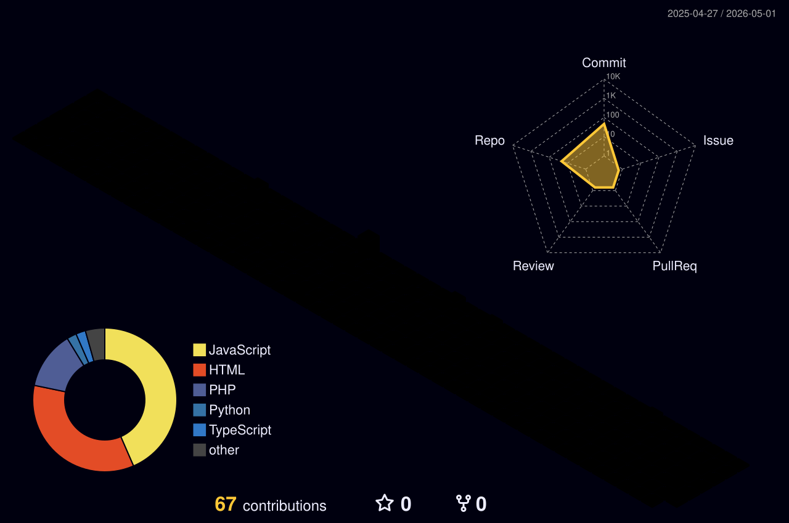

<!-- ═══════════════════════════ HEADER ═══════════════════════════ -->
<div align="center">

<a href="https://github.com/ESTAS-crypto/portofolio">
  
</a>

<br/>

<a href="mailto:evanatharasya@gmail.com"></a>
<a href="https://linkedin.com/in/evanatharasya"></a>
<a href="https://instagram.com/evanatharasya.x"></a>
<a href="https://github.com/ESTAS-crypto/portofolio"></a>

<br/><br/>


</div>


<!-- ═══════════════════════════ ABOUT ═══════════════════════════ -->

## 👋 About Me

I'm a **full-stack developer from Indonesia** who builds practical, good-looking software: web apps, e-commerce platforms, financial tools, and AI-powered chatbots. I care about clean interfaces, maintainable code, and shipping things people actually use.

```ts
const evan = {
  role: "Full-Stack Developer",
  location: "Indonesia 🇮🇩",
  currently: {
    building: ["AI-powered tools", "Next.js web apps", "automation bots"],
    learning: ["TypeScript (deeper)", "Machine Learning", "System design"],
  },
  interests: ["Web (frontend + backend)", "AI & chatbots", "Crypto & blockchain", "UI/UX"],
  openTo: ["Freelance projects", "Open-source collaboration"],
  principle: "Every line of code is a step toward something useful.",
} as const;
```


<!-- ═══════════════════════════ TECH ═══════════════════════════ -->

## 🧰 Tech Stack

<div align="center">

<table>
  <tr>
    <td align="center" width="150"><b>Languages</b></td>
    <td>
      <a href="https://skillicons.dev"></a>
    </td>
  </tr>
  <tr>
    <td align="center"><b>Frontend</b></td>
    <td>
      <a href="https://skillicons.dev"></a>
    </td>
  </tr>
  <tr>
    <td align="center"><b>Backend</b></td>
    <td>
      <a href="https://skillicons.dev"></a>
    </td>
  </tr>
  <tr>
    <td align="center"><b>Database &amp; Cloud</b></td>
    <td>
      <a href="https://skillicons.dev"></a>
    </td>
  </tr>
  <tr>
    <td align="center"><b>DevOps &amp; Tools</b></td>
    <td>
      <a href="https://skillicons.dev"></a>
    </td>
  </tr>
</table>

</div>


<!-- ═══════════════════════════ SERVICES ═══════════════════════════ -->

## 💼 What I Can Build For You

<div align="center">

| 🌐 Web Apps &amp; Dashboards | 🛒 E-commerce | 🤖 AI Chatbots &amp; Bots | 📊 Business Systems |
|:---:|:---:|:---:|:---:|
| Responsive, fast, and modern UIs with Next.js, React, and Laravel | Storefronts, carts, and admin panels | Chatbots and automation that save hours of manual work | Financial management, reporting, and internal tools |

<a href="mailto:evanatharasya@gmail.com?subject=Project%20inquiry"></a>

</div>


<!-- ═══════════════════════════ PROJECTS ═══════════════════════════ -->

## 🚀 Featured Projects

<div align="center">

<a href="https://github.com/ESTAS-crypto/nextjs-ai-chatbot"></a>
<a href="https://github.com/ESTAS-crypto/GenZMart-PRO"></a>
<a href="https://github.com/ESTAS-crypto/TRYOUT-SNBT"></a>
<a href="https://github.com/ESTAS-crypto/ManajemenKeuangan"></a>

<br/>

<details>
<summary><b>📂 More projects</b></summary>
<br/>

| Project | What it does | Stack | Stars |
|:---|:---|:---:|:---:|
| 🌐 **[portofolio](https://github.com/ESTAS-crypto/portofolio)** | Personal portfolio website with a modern UI |  |  |
| 💡 **[AI-GRATIS](https://github.com/ESTAS-crypto/AI-GRATIS)** | Curated collection of free AI tools |  |  |
| 📊 **[Laporan-ibuk-](https://github.com/ESTAS-crypto/Laporan-ibuk-)** | Report management system |  |  |
| 📍 **[track-location](https://github.com/ESTAS-crypto/track-location)** | Location utility written in Python |  |  |

</details>

<a href="https://github.com/ESTAS-crypto?tab=repositories"></a>

</div>


<!-- ═══════════════════════════ STATS ═══════════════════════════ -->

## 📊 GitHub Activity

<div align="center">


<br/>


</div>

<details>
<summary><b>⚡ More analytics</b></summary>
<br/>
<div align="center">


</div>
</details>


<!-- ═══════════════════════════ GAMES ═══════════════════════════ -->

## 🎮 Contribution Skyline and Games

<div align="center">
  

  <br/><br/>

  <picture>
    <source media="(prefers-color-scheme: dark)" srcset="https://raw.githubusercontent.com/ESTAS-crypto/ESTAS-crypto/output/github-snake-dark.svg" />
    <source media="(prefers-color-scheme: light)" srcset="https://raw.githubusercontent.com/ESTAS-crypto/ESTAS-crypto/output/github-snake.svg" />
    
  </picture>

  <br/><br/>

  <picture>
    <source media="(prefers-color-scheme: dark)" srcset="https://raw.githubusercontent.com/ESTAS-crypto/ESTAS-crypto/output-pacman/pacman-contribution-graph-dark.svg" />
    <source media="(prefers-color-scheme: light)" srcset="https://raw.githubusercontent.com/ESTAS-crypto/ESTAS-crypto/output-pacman/pacman-contribution-graph.svg" />
    
  </picture>
</div>

<!-- ═══════════════════════════ FOOTER ═══════════════════════════ -->

<div align="center">

### ⭐ Like what you see?

Star a repo, follow along, or just say hi. Collaboration and feedback are always welcome.

<a href="https://github.com/ESTAS-crypto"></a>
<a href="https://github.com/ESTAS-crypto?tab=repositories"></a>

<br/>


<sub>© 2025–2026 Evan Atharasya · <a href="https://github.com/ESTAS-crypto">@ESTAS-crypto</a></sub>

</div>
